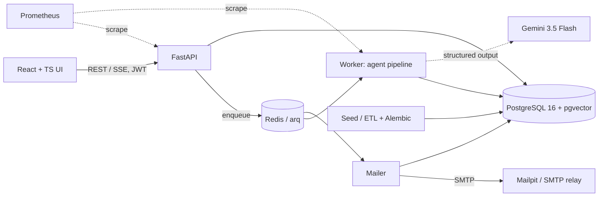

# Supply Chain Disruption Copilot

An AI-assisted **decision system** (not a chatbot) for the Olist Brazilian e-commerce dataset. You type a disruption such as *"Heavy rains are delaying all freight leaving Sao Paulo for the next 5 days"*. Specialised agents then:

1. turn it into a validated, editable interpretation;
2. find the in-flight orders, SKUs and sellers it touches;
3. forecast each order's new delivery date and the risk of missing the promised date;
4. decide per order whether to **cancel, reroute or delay** (with compensation);
5. draft personalised, fact-checked customer emails;
6. write an impact summary with operational recommendations.

Every number shown can be traced back to the data and the rule that produced it.

The design blueprint is in [`PLAN.md`](PLAN.md). This README covers what was built.

---

## Quick start (Windows, macOS, Linux)

Requirements: **Docker Desktop** (or Docker Engine + Compose v2.24+) with about 6 GB of memory available to Docker. Nothing else is needed on the host. Works on Windows (WSL 2), macOS (Intel and Apple Silicon) and Linux.

```bash
cp .env.example .env          # Windows PowerShell: Copy-Item .env.example .env
# optional: put a Gemini API key in .env (free at https://aistudio.google.com). Without one the system runs offline.
docker compose up --build
```

| URL | What |
|---|---|
| **http://localhost:8080** | The application. Create an account ("Create one" on the sign-in page; new accounts are analysts) or use a demo account shown there: `analyst@example.com` / `analyst-demo` (runs scenarios, edits drafts), `approver@example.com` / `approver-demo` (also approves and sends emails), `admin@example.com` / `admin-demo` (also manages users and roles) |
| http://localhost:8025 | Mailpit inbox: approved customer emails are delivered here over SMTP |
| http://localhost:8000/docs | OpenAPI (local machine only) |

On first start the `seed` container loads the Olist CSVs (from `./data/raw/` if present, otherwise downloaded with `kagglehub`), validates them, builds the snapshot and embeds 17,603 retrieval documents on CPU. Expect **10–15 minutes** for the first `up` (image builds plus about 10 minutes of seeding; measured 592 s on a laptop CPU); later starts skip the seed (fingerprinted) and take seconds, and a rebuild only re-embeds documents whose text changed (embedding cache). `docker compose up -d` returns once the seed has finished and the API is healthy. If the download is blocked, get the dataset from <https://www.kaggle.com/datasets/olistbr/brazilian-ecommerce> and extract the CSVs into `./data/raw/` (mounted read-only).

| Task | Command (`make` target in brackets) |
|---|---|
| Backend unit tests / static analysis | `docker compose run --rm --no-deps api pytest` (`make test`) · `... api ruff check app tests migrations` (`make lint`) |
| Run a scenario from the CLI (no UI) | `docker compose run --rm api python -m app.cli run "Last-mile courier strike in Rio de Janeiro for 3 days"` |
| Regenerate the deliverable samples | `docker compose --profile tools run --rm tools python -m app.cli samples` (`make samples`) |
| Backtest against real events | `docker compose --profile tools run --rm tools python -m app.cli backtest` (`make backtest`) |
| Parsing + retrieval evaluation | `docker compose --profile tools run --rm tools python -m app.cli eval` (`make eval`; add `--llm` to score the LLM interpreter) |
| Create a real user | `docker compose run --rm api python -m app.cli create-user --email you@company.com --role approver` |
| Monitoring (Prometheus at http://localhost:9090) | `docker compose --profile observability up -d prometheus` (`make observability`) |
| Headless-browser UI check (stack running) | `docker run --rm --network supply-chain-copilot_default -v "$PWD/e2e/out:/out" -v "$PWD/e2e/ui_check.py:/ui_check.py:ro" mcr.microsoft.com/playwright/python:v1.48.0-jammy sh -c "pip install -q playwright==1.48.0 && python /ui_check.py http://web:8080 http://mailpit:8025"` (screenshots in `e2e/out/`; in Windows PowerShell use `${PWD}`) |
| Rebuild the snapshot at another date | `docker compose run --rm api python -m app.cli etl --force --as-of 2018-06-01T00:00:00` |

On Linux, `make samples/backtest/eval` runs the `tools` container with your uid so the reports in `./samples` belong to you (Docker Desktop on Windows/macOS needs nothing).

---

## Architecture



| Service | Role |
|---|---|
| `postgres` | System of record: snapshot, statistics, retrieval documents (pgvector HNSW + full-text GIN), runs, decisions, emails, users, LLM call log, audit log, embedding cache. Schema managed by Alembic |
| `redis` | Job queues (pipeline, mail) and the login-throttling counters |
| `seed` | One-shot ETL: load → validate → time-masked snapshot → features → documents → embeddings (idempotent, cached) |
| `api` | FastAPI: sign-in, interpretation + live preview, runs, SSE events, orders, emails workflow, search, exports, `/metrics` |
| `worker` | arq worker that executes the agent pipeline and bulk email drafting |
| `mailer` | arq worker on its own queue that delivers approved emails over SMTP with retries (never waits behind a pipeline run) |
| `mailpit` | Local SMTP server with a web inbox, standing in for the customer mail relay |
| `web` | Unprivileged nginx serving the React build and proxying `/api` (SSE-safe), with security headers |
| `tools` *(profile)* | One-off CLI commands that write reports into `./samples` |
| `prometheus` *(profile)* | Scrapes the API and worker metrics |

### Agents and how they collaborate

A deterministic **supervisor** runs the agents as a DAG. Each agent has a typed contract, writes its results to Postgres and streams progress events, which the UI shows live in the agent timeline. A free-roaming agent loop is unnecessary because the shape of the task is known in advance. The design uses LLM autonomy only where it adds value, which keeps runs predictable, auditable, cost-bounded and testable.

| # | Agent | Does | Engine |
|---|---|---|---|
| 1 | **Intake** | Free text → `DisruptionSpec` (place roles, legs, window, product terms, ambiguities). Places are grounded against a gazetteer of the dataset's cities and states. | LLM structured output + deterministic grounding; rule parser fallback |
| 2 | **Scout** | Exact scope: which order lines match the geography (state / city / radius / lane), legs and product filter. Hybrid retrieval then ranks evidence: impacted orders, heavy/bulky SKUs, exposed sellers, applicable policy. | SQL-grade filters + RAG |
| 3 | **Logistics Analyst** | Per leg (first mile / linehaul / last mile): days held by the disruption window + backlog recovery → projected ETA (p50/p90) from empirical lane distributions → P(miss promise) → severity 0–100 with a per-component breakdown (SLA breach, breach probability, freight weight, value, seller reliability, complexity). | Deterministic |
| 4 | **Mitigation** | Policy-as-code rules R0–R8 per item: perishable → cancel & refund; same SKU from a seller outside the disrupted area → reroute; small parcel blocked at origin → alternate route; bulky → delay & compensate; gifts / essentials / long delays → cancellation offered. Compensation tiers are deterministic. The most severe flagged cases (mixed items, uncertain product type) are handled by a **tool-using investigator**: in up to 3 steps it calls read-only tools (`delivery_forecast`, `alternatives`, `compare_plans`, `customer_orders`, `policy`), reads their results and chooses between the rule plan and "delay all", citing what it found. Remaining flagged cases go to a batch **LLM adjudicator** with the same two options. | Rules + bounded LLM agent |
| 5 | **Customer Success** | One email per customer (orders consolidated). The LLM sees only a pre-formatted fact sheet and writes for the highest-severity customers; grounded templates cover the rest (cost control). Drafting more with AI is available on demand. | LLM + templates |
| 6 | **QA Critic** | Checks every draft: each date, R$ amount, percentage and number must exist in the facts; only allowed link placeholders; no voucher or refund that wasn't granted; no guarantees, blame or internal jargon; required content; length; language. Failing drafts go back to the writer with the reasons (up to 2 rounds), then fall back to the template. | Deterministic |
| 7 | **Reporter** | Deterministic statistics and operational recommendations. The LLM writes the executive narrative, and any number in it that isn't in the stats sends it back for a retry or replaces it with the template. | Deterministic + LLM |

### Reasoning and planning approach

- **The plan is fixed; the steps reason.** The shape of the task is known in advance (interpret → scope → assess → decide → communicate → verify → report), so a deterministic supervisor runs it as a DAG rather than letting an LLM plan the next step. That keeps every run reproducible (versioned config, prompts and models are snapshotted), cost-bounded and auditable.
- **Each step reasons over typed facts from the previous one.** Intake produces a validated `DisruptionSpec`; the Scout turns it into matched order lines, each with the rule that matched it; the Analyst turns those into per-leg holds, ETAs and breach probabilities; the Mitigation agent turns those into actions and compensation; Customer Success turns decisions into a facts sheet and then an email. No step re-derives what an earlier step decided.
- **Bounded autonomy where judgement helps.**
  - The LLM interprets free text, then deterministic grounding checks it (gazetteer, schema validation, and a cross-check against the rule parser).
  - The LLM investigates the most severe flagged orders with read-only tools (a bounded ReAct loop with schema-constrained steps; every tool call and result is kept in the order's reasoning trace), and adjudicates the rest, but may only choose among options the policy allows.
  - The LLM writes emails and the narrative, and a deterministic critic verifies every figure.
- **Feedback loops instead of blind trust.**
  - The QA critic sends failing drafts back to the writer with the reasons (up to 2 rounds), then falls back to a grounded template.
  - The narrative is retried, or replaced, if it uses a number that is not in the statistics.
  - Ambiguous places are surfaced to the analyst with the impact of each reading before anything runs.
- **Degrade, don't fail.** If the LLM is unavailable (no key, quota, outage), every LLM step has a deterministic counterpart, and the run completes in offline mode.

### Multi-step reasoning: disruption → SKUs → customer

Each order stores a trace that the UI shows in the order drawer (illustrative values):

```
Disruption "Heavy rains leaving Sao Paulo" (origin SP, first_mile+linehaul, Aug 1 → Aug 6 + 2 recovery days)
 └─ matched ORIGIN_STATE:SP · seller 7c1e… (sao paulo/SP) · destination Belo Horizonte/MG
     └─ Order 3F2A… awaiting pickup · promised Aug 8
         └─ SKU 9a8b…: Furniture Decor · 35.0 kg billable · BULKY · lane SP->MG (p50 4.0d / p90 7.2d) · first_mile held 5.0d
             └─ ETA Aug 5 → Aug 12 (p90 Aug 15) vs promise Aug 8: 4 days late · P(miss) 100%
                 └─ Severity 72 (high): sla_breach 20.0, breach_probability 15.0, freight_weight 20.0, …
                     └─ DELAY_WITH_COMPENSATION (rule R5): bulky freight is uneconomical to reroute; Moderate delay tier
                         └─ Email (llm, QA passed)
```

### LLM vs deterministic logic

| Step | Approach | Why |
|---|---|---|
| Parse the scenario | LLM (schema-constrained JSON) → gazetteer grounding → Pydantic validation; rules offline | Open language in, typed and validated data out |
| Geography → orders | Deterministic filters | Must be exact and auditable; vectors can't guarantee recall |
| Product terms → categories | Lexical + keyword + semantic (embeddings) | Fuzzy PT/EN concepts |
| ETA, breach risk, severity | Deterministic (empirical lane distributions) | Numbers must be correct and reproducible |
| Actions, compensation | Policy-as-code (`config/policy.yaml`, rules in `policy_engine.py`) | Financial and customer impact |
| Edge-case judgement | LLM, restricted to policy-allowed options | Judgement where rules run out, inside guardrails |
| Emails, executive narrative | LLM + deterministic fact checker | Language is what LLMs are good at; the facts come from code |
| Approval | Human (approve / edit / regenerate / reject; edits are re-checked by QA) | Outward-facing communication |

### Retrieval (RAG)

- **Index** (`documents` table): about 10k order documents, their products and sellers, 73 categories and the policy knowledge base chunks. Document text is generated from typed fields plus derived tags (for example *heavy bulky oversized* for bulky items), so "heavy/bulky" is semantically retrievable even though Olist has no such field.
- **Embeddings**: `paraphrase-multilingual-MiniLM-L12-v2` via fastembed (ONNX, CPU, Portuguese + English). It is baked into the image, so no key is needed and it works offline.
- **Hybrid search**: pgvector cosine (HNSW, iterative scan with filters) + Postgres full-text (`unaccent`, field-weighted OR-prefix tsquery), fused with **Reciprocal Rank Fusion** (k=60), plus metadata filters. The top 30 fused candidates are then re-scored by a **cross-encoder reranker** (`ms-marco-MiniLM-L-6-v2`, ONNX, baked into the image). See `app/services/retrieval/hybrid.py` and `reranker.py`.
- **Retrieve-then-verify**: every run also lets hybrid search alone propose the impacted orders and checks them against the exact scope. On the São Paulo scenario it recovers 87% of the top 200 (precision 87%), which is the measured reason scope is decided by exact filters.
- **Used by**: the Scout (concept resolution and ranked evidence), the policy citations attached to every decision, the tone guide given to the email writer, the investigator's `policy` tool, and the **Retrieval explorer** page, where dense, sparse, hybrid and reranked rankings can be compared.
- `python -m app.cli eval` reports Recall@5 / MRR for each mode on labelled concept queries.

### Time travel and backtesting

Olist is historical (2016–2018). The ETL rebuilds the world **as of `AS_OF`** (default 2018-08-01), masks every timestamp after it and derives each order's stage from what was known then. Lane and seller statistics use only earlier deliveries, so nothing leaks. The unmasked actuals are stored separately, and a test enforces that runtime code never reads them. This makes it possible to **backtest against real events**: `app.cli backtest` replays the May 2018 truckers' strike, Black Friday 2017 and Carnival 2018 (plus a calm control period) and scores the predictions against what actually happened, including Brier scores, reliability tables and leave-one-event-out recalibration.

---

## Verified results

All numbers below come from the running system (Docker on Windows 11, snapshot as of 2018-08-01). They are reproducible with the commands in the quick-start table.

| Check | Result (v1.2) |
|---|---|
| Unit tests | **123 passed** (107 backend + 16 API-contract checks that compare `web/src/api/types.ts` with the Pydantic models): parsing and grounding, prompt-injection and negation handling, ETA/impact, scoring, policy, QA critic and fact checker, customer-email honesty, retrieval document layout, schema conversion, LLM breaker, run liveness, leakage guard, auth (password hashing, JWT expiry/forgery, roles, API key, live account check, sign-up validation, admin self-lock-out), metrics labels, email construction, investigator tools and loop bounds, backtest metrics and Platt fit, Alembic revision chain. `ruff` (pyflakes + bugbear) is clean |
| Cold start on empty volumes | `docker compose down -v` then up: Alembic migrated an empty database from zero, the seed loaded the CSVs from the read-only `./data/raw` drop-in, embedded 17,603 documents and finished in **592 s** (a later config-change rebuild took **44 s**: all 17,603 embeddings came from the cache); every service reported healthy (API readiness, `arq --check` for both workers). An existing v1.1 database was stamped at the baseline and upgraded in place; `alembic check` reports models and migrations in sync |
| Non-root containers | Backend images run as uid 10001, nginx as uid 101; models are read-only and loaded with `HF_HUB_OFFLINE=1` (verified with `--network none`) |
| Security behaviour | No token → 401; analyst approving → 403; analyst opening user management → 403; 11th wrong password in 15 min → 429; sign-up always yields an analyst (201), duplicate email → 409, weak password → 422; a deactivated user's existing token → 401; admin demoting themselves → 422; `/metrics` and the API port bound to localhost only and not proxied by the web server; CSP, `X-Frame-Options: DENY`, `nosniff` and `Referrer-Policy` on every page; access tokens stripped from nginx access logs |
| UI (headless Chromium) | Sign-up (lands as analyst) → sign-in as analyst (no Users page) → scenario → interpretation → ambiguity switch → run → every tab → order drawer → emails (approve disabled for the analyst) → explorer → about → sign-in as approver → **approve & send → delivered to the Mailpit inbox and shown as "sent" without a reload** → sign-in as admin → promote the new account to approver on the Users page → phone width. No JavaScript errors, no failed requests, no horizontal overflow at 390 px |
| Clean-room install | The submission archive extracted into an empty folder with **no data** and `.env` copied from `.env.example` (offline mode), started under a separate Compose project: the non-root seed downloaded the dataset from Kaggle and finished in 567 s, every service came up healthy, and the full headless-browser journey above passed, from sign-in to approve and send, with the email delivered to the Mailpit inbox |
| Snapshot | 10,000 orders indexed, **2,120 in flight** (130 pending, 547 awaiting pickup, 1,443 in transit); 428 lane distributions from 88,040 earlier deliveries; 17,603 retrieval documents. Orders excluded because of a cancellation that may have happened after AS_OF: 59 of 6,131 (about 1%) in the last 30 days |
| Scenario 1: *heavy rains leaving São Paulo, 5 days* | 1,409 orders in scope, **681 delayed, 398 miss the promise**; 325 rerouted via alternate carrier, 1 re-sourced from another seller, 62 delayed with compensation, 10 perishable orders cancelled and refunded, 283 heads-ups, 728 monitored silently; 679 emails, **QA 679/679**. (v1.0 reported 1,216 delayed before fix #1 removed shipments that had already left SP) |
| Scenario 2: *last-mile courier strike in Rio, 3 days* | 270 orders in scope, **81 delayed, 23 miss the promise**; 71 emails, **QA 71/71** |
| Parsing eval | **124/124 fields correct across 40 scenarios** (Portuguese, hour/week units, lanes, regions, product terms, seller-side outages, negated clauses and two prompt-injection cases) for **both** the deterministic parser and the LLM interpreter (Gemini; most cases ran on the `flash-lite` fallback because the free-tier quota of the primary model was spent). Expanding the set from 10 to 40 cases exposed five parser gaps (hailstorm, "overloaded" capacity, a negated clause, an injected `nationwide=true`, seller-side places), which were fixed and covered by tests |
| Retrieval eval (category concepts, top 5) | Recall@5 / MRR: dense 0.94 / 0.95, sparse 0.79 / 0.80, hybrid 0.91 / 0.92, **hybrid + cross-encoder rerank 0.95 / 0.94 (default)** |
| Attribute retrieval ("heavy bulky furniture shipped from Sao Paulo", top 10 orders) | Sparse: 10/10 bulky orders after fixes 12–13 (0 bulky in the top 20 before). Hybrid: a bulky order ranks first. Dense alone still prefers medium-weight furniture: the small multilingual model encodes "furniture" far more strongly than "heavy", which is why the system fuses both legs |
| Concept resolver | Precision 88%, recall 82% (precision was 62% before coverage-aware lexical matching) |
| Backtest on three real events | Recall of truly late orders, baseline → this system: truckers' strike 2018 (2,726 in-flight orders) **20% → 84%**, Black Friday 2017 18% → 42%, Carnival 2018 25% → 42%; **F1 improves in 3 of 3 events** (0.34 → 0.47, 0.29 → 0.42, 0.40 → 0.55). The best partial-impact factor differs per event (0.5, 0.75, 1.0), so the default stays 1.0. Honest finding: the breach probability is conditional on the scenario happening exactly as described, so as a real-world forecast it is over-confident (strike Brier 0.408 vs baseline 0.123); leave-one-event-out Platt recalibration brings it to 0.174 / 0.124 / 0.116, still not better than the baseline. Disruption awareness pays off in ranking and recall, not in calibrated probabilities. Full report: [`samples/backtest_truckers_strike_2018/report.md`](samples/backtest_truckers_strike_2018/report.md) |
| Tool-using investigator (live, Gemini) | São Paulo run: the two most severe flagged orders were investigated in 3 steps each. One called `delivery_forecast`, `compare_plans` and `policy` and kept the rule plan; the other also called `alternatives` and chose delay-all with compensation. The other 4 flagged orders went to the batch adjudicator |
| Live operational checks | Orphaned run reaped within 10 s and retried successfully; "Regenerate with AI" produces a new QA-passing draft each time; a human edit adding "by the 15th" is flagged `qa_failed` and approval is blocked (HTTP 409); the web proxy survives API restarts; JSON declares `charset=utf-8` |

Sample outputs: [`samples/`](samples/) (impact reports, order CSVs, sample emails with their QA checklists, backtest and evaluation reports).

### Operating on the Gemini free tier

The free tier allows **20 requests per day per model**. The LLM gateway therefore uses:
- a **model fallback chain** (`gemini-3.5-flash` → `gemini-3.5-flash-lite` → `gemini-3.1-flash-lite`, set with `LLM_FALLBACK_MODELS`). An exhausted model is skipped until the reset time Google reports;
- a **response cache**, so identical requests (re-runs, evals) cost nothing;
- **email batching** (5 customers per call) and an LLM email cap (`MAX_LLM_EMAILS`); the remaining customers get grounded templates and can be drafted on demand;
- **retries with backoff** for 503 "high demand" spikes, plus one deferred retry pass for email batches;
- a **deterministic cross-check of the interpretation**: if a (smaller) model drops the location named in the text, the rule parser's reading is used and flagged for review.

When every model is exhausted, runs still complete in deterministic mode (rule parser, templates, template narrative) and are marked `degraded`.

## Code review fixes (v1.1)

A self-review of v1.0 found the issues below. Each was confirmed against the running system (or traced in code), fixed, and covered by a regression test (`tests/test_engine.py`, `tests/test_policy_and_qa.py`, `tests/test_ops.py`).

| # | Problem found | Evidence | Fix |
|---|---|---|---|
| 1 | **Regional disruptions delayed freight that had already left the region.** For "rain leaving São Paulo", the linehaul leg held every in-transit shipment for its whole journey overlapping the window. | 594 of 1,405 delayed items (42%) in the v1.0 São Paulo run had left SP more than a day earlier | A regional disruption only exposes the part of the linehaul inside the region (first day after handover at origin, last day before the last mile at destination). Nationwide / lane / seller-only disruptions still expose the whole corridor (A7) |
| 2 | **The QA fact checker missed indirect dates and durations** | "by the 15th", "within five business days", "next Tuesday" passed; "24/7" was flagged as a date | Ordinal dates, number words with time units and relative dates/weekdays (EN + PT) are now checked; "24/7" is whitelisted; the email prompt forbids them up front |
| 3 | **Seller/supplier outages could be "rerouted via alternate carrier"**, although the goods are not ready to ship | Rule R4 ignored the disruption type | R4 only applies to transport disruptions (weather, strike, infrastructure, capacity); outages fall back to re-sourcing (R3) or delay |
| 4 | **The API's LLM circuit breaker never closed**, so interpretation stayed in rule mode until a restart (even after the daily quota reset) | Only the worker reset it, per run | The breaker is half-open after a cooldown (`LLM_BREAKER_COOLDOWN_S`), or after the earliest model quota reset when every model is exhausted |
| 5 | **"Regenerate with AI" returned the identical email** from the second click on | Same request, so a response-cache hit | Explicit regeneration bypasses the cache |
| 6 | **Runs could be stuck in "running" forever** after a worker restart or crash, and could not be retried or canceled | Retry was only allowed for failed/canceled runs | Runs send a heartbeat; a reaper (worker startup + every minute) marks orphaned runs as failed; queued runs whose job was lost are re-enqueued; cancel/retry accept orphaned runs; a live run is never executed twice |
| 7 | The timeline of a **retried** run showed stages as done from the failed attempt | Old events replayed | The UI only considers events since the latest `run_started` and re-subscribes on retry |
| 8 | Running services kept a **stale snapshot after an ETL rebuild** | Process-wide cache, never invalidated | The dataset fingerprint is checked every 15 s and the snapshot reloads when it changes |
| 9 | The snapshot excluded orders **canceled after AS_OF** using later knowledge | Olist has no cancellation timestamp | Kept as a documented limitation (the alternative injects phantom in-flight orders) and quantified in the dataset meta: 59 of 6,131 orders (about 1%) in the last 30 days |
| 10 | **Emails blamed the disruption for orders that were already late.** An order promised on Jul 5 got "severe weather is affecting your delivery" for rain starting Aug 1 | 110 of 681 delayed orders (16%) in the São Paulo run would have been late anyway | The facts sheet flags `already_late_before_disruption`; templates (EN/PT) and the LLM prompt acknowledge the existing delay instead of presenting the disruption as the only cause |
| 11 | Region names with a qualifier ("Northeast region", "Região Nordeste") were not recognised | Gazetteer only matched the bare name | Region qualifiers are normalised |
| 12 | **The embedding model never saw the semantic tags.** "heavy bulky furniture" ranked 0.3 kg parcels first in the explorer | The derived tags (`heavy bulky oversized…`) were the *last* line of each document, beyond the ~128-token window the multilingual MiniLM model is trained on | Tags now follow the header line of every order, product and seller document (regression test `tests/test_documents.py`); snapshot re-embedded |
| 13 | **Full-text ranking ignored where a term appears**: place names repeated in the body outranked the tags | Unweighted `tsvector` | Field-weighted index: tags (A) > title (B) > body (D) |
| 14 | Removing an ambiguous place chip (e.g. "SP (state)") **did not stick**: the next live preview re-added it | The server re-applies each ambiguity's chosen option | Removing a chip also removes that ambiguity for that role |
| 15 | "Draft with AI" could queue a whole page (50) of drafts, **draining the daily free-tier quota in one click** | No cap | At most 10 drafts per request (highest severity first), enforced in the UI and the API (`MAX_BULK_DRAFTS`) |
| 16 | The Runs table **overflowed horizontally on phones** (426 px) | Headless-browser check at 390 px width | The table scrolls inside its card |

Improvements made in the same pass:
- **Fewer unnecessary emails:** an on-time order whose ETA moves is only contacted when the shift is at least 2 days or the breach risk is at least 20% (was 0.5 days). Policy and knowledge base are updated.
- **Better breach probability for in-transit orders:** it is now conditioned on the time already spent in transit.
- **Calibration knob:** a `partial_impact_factor` assumption (A8), swept by the backtest.
- **Portuguese emails** use accented Portuguese product names.
- **Scenario page:** editing the text clears the stale interpretation.
- **Faster first request:** the API preloads the embedding model and snapshot at startup.
- **Event stream:** a pure ASGI request middleware replaces `BaseHTTPMiddleware`, so the SSE stream detects closed tabs.
- **Narrower ETL fingerprint:** it now covers only ETL-relevant config, so editing the policy no longer forces a full rebuild. A small idempotent migration step (`app/db/session.py: MIGRATIONS`) applies additive schema changes.
- **Explicit `charset=utf-8` on JSON:** the API now declares the charset, because some clients (Windows PowerShell 5.1) decoded Portuguese text as Latin-1 without it.
- **Readable reports:** the impact reports show readable decision labels (with the rule code alongside) instead of internal codes.
- **Static analysis:** `ruff` (pyflakes and bug-risk rules) passes with no findings.
- **Pipeline coverage:** six further scenario types (radius, lane, nationwide, product-only, Portuguese, seller outage) run end to end with 0 QA failures across 2,859 emails.
- **UI verified in a real browser:** a headless Chromium walkthrough in Docker covers scenario → interpretation → ambiguity switch → run → every tab → order drawer → emails → explorer → about → mobile width. It found no JavaScript errors and no failed requests.
- **Readable labels everywhere:** the severity breakdown reads "SLA breach (days late)" rather than "Sla Breach", and the agent timeline lists decisions by name instead of internal codes.

Effect on the São Paulo sample: delayed orders 1,216 → 681, missing the promise 550 → 398, customer emails 1,207 → 679 (heads-ups 664 → 283). The Rio last-mile scenario keeps 81 delayed orders (no linehaul involved), and its emails drop 81 → 71.

**Retrieval scope, stated plainly:** the scope of a disruption is decided by exact structured filters. Retrieval resolves product concepts (it drives the product filter) and supplies the policy sections cited in every decision and in the email tone guide. The ranked evidence lists (most relevant orders, bulky SKUs, exposed sellers) are explanatory and do not change decisions.

## Assumptions (dataset limitations → design)

The full register (A1–A19) with parameters is in [`backend/config/assumptions.yaml`](backend/config/assumptions.yaml). It is served at `/api/v1/reference/assumptions`, shown on the "How it works" page and snapshotted into every run. Highlights:

- **Simulation clock and stages** (A1, A3): order state is reconstructed at `AS_OF`; only non-delivered orders are actionable.
- **SLA** = `order_estimated_delivery_date`; seller SLA = `shipping_limit_date` (A4).
- **Freight legs** (A5–A8): first mile at the seller's location, linehaul, last mile (final day) at the customer's location. Transit = empirical carrier→customer distribution per state lane with fallbacks. In-transit orders handed over within 1 day are still in the origin region. Backlog recovery = ceil(0.3 × duration).
- **Billable weight and handling profiles** (A9, A10): Correios-style volumetric weight; PARCEL / MEDIUM / BULKY thresholds.
- **Product classes** (A11): a curated category → class map (perishable, essential, fragile, tech, gifts, furniture/home).
- **Alternate fulfilment** (A12, A13): the same `product_id` sold recently by a seller outside the disruption, assuming stock is available; alternate carrier/air for parcels at +60% freight.
- **Customers** (A14): synthetic first names (Olist has no PII); approved emails are delivered over SMTP to placeholder addresses on a reserved domain (`customer-…@customers.example`), which land in the local Mailpit inbox.
- **"Sao Paulo" / "Rio de Janeiro"** (A18): state vs city is resolved by qualifiers. Otherwise it defaults to the state, the ambiguity is shown, and the preview counts for both readings are displayed so the analyst can switch.

## Key design decisions and tradeoffs

| Decision | Tradeoff |
|---|---|
| Orchestrated DAG with agentic steps rather than an autonomous planner | Predictable, testable and cost-bounded; less "emergent" behaviour (none is needed here) |
| Postgres + pgvector for everything | One consistent store; full-text ranking is not true BM25 (fine at this scale; `hybrid_search` is the swap point) |
| Local multilingual embeddings | Offline, free and reproducible; somewhat lower quality than large hosted models |
| Exact filters for scope + semantics for concepts | Correct recall on geography; semantic matching only where language is fuzzy |
| Policy-as-code + bounded LLM adjudication | Financial decisions are deterministic and explainable; the LLM cannot exceed policy |
| Empirical lane ECDF instead of an ML ETA model | Transparent and calibrated on sparse lanes; an ML model is a drop-in later |
| LLM emails for top-N customers + templates + on-demand AI drafting | Bounded cost and latency on free-tier rate limits; quality where severity is highest |
| Gemini free tier as the LLM | Zero cost. Mitigated with throttling (RPM + concurrency), retries with backoff, a response cache, batching (5 emails per call) and a circuit breaker that degrades to templates |
| Schema-constrained output + deterministic validators | Hallucinated numbers or policies are caught before a human sees them |
| Tool-using investigator only for the most severe flagged cases (`MAX_AGENT_CASES`, default 2, at most 3 steps) | Real investigation where judgement matters most, at a bounded cost of a few calls per run on a 20-requests/day free tier |
| Email delivery through a separate mail worker and queue | Approval returns immediately, delivery retries independently, and a long pipeline run never delays a send |
| Login with JWT + roles instead of an external identity provider | Self-contained and testable offline; OIDC can replace `current_user` without touching the routes, which only depend on roles |

## Production readiness (v1.2)

The v1.1 README listed what was missing for production. v1.2 closes those gaps:

| Area | Implementation |
|---|---|
| **Authentication and roles** | Email + password sign-in (scrypt hashes, stdlib), HS256 JWT bearer tokens (`JWT_TTL_MINUTES`), roles `analyst` < `approver` < `admin` enforced in FastAPI dependencies: only approvers approve, reject and send. The token proves identity, but every request checks the account in the database, so an admin's role change or deactivation applies immediately (a deactivated user's existing token gets 401). `X-API-Key` is a service credential (admin). Failed logins are throttled in Redis (10 per account per 15 min → 429). Every edit, approval, send, sign-up, sign-in and role change is in the audit log with the real user. `AUTH_ENABLED=false` turns sign-in off for local experiments |
| **Sign-up and user management** | Self-service sign-up (`ALLOW_SIGNUP`, off by default in code and on in the demo stack) always creates an **analyst**, so nobody can grant themselves approval rights. It can be limited to company domains (`SIGNUP_ALLOWED_DOMAINS`), is rate-limited per IP (5 per hour), validates email and password strength, and signs the new user in. Admins promote, demote, deactivate and reactivate accounts on the **Users** page; an admin cannot demote or deactivate themselves (no lock-out). Demo accounts are seeded only with `DEMO_USERS=true`; `app.cli create-user` creates accounts from the command line |
| **Database migrations** | Alembic (`backend/migrations`): an autogenerated baseline plus a revision for users, email delivery and the embedding cache. Every process runs `upgrade head` under a Postgres advisory lock (safe with several API replicas); databases created by v1.1 are stamped at the baseline and upgraded in place. CI checks that models and migrations match (`alembic check`) and that downgrade/upgrade round-trips |
| **Containers** | Backend runs as uid 10001 and nginx as uid 101 (`nginx-unprivileged`). State lives in named volumes; the host's `./data/raw` is mounted read-only as a CSV drop-in. Models are baked into the image and loaded with `HF_HUB_OFFLINE=1`, so the runtime never calls the model hub. Healthchecks: API readiness (database, dataset, Redis) and `arq --check` for both workers |
| **Customer email delivery** | Approving queues delivery on the `mailer` worker, which sends over SMTP (Mailpit locally, any relay via `SMTP_*`), retries with backoff, records `sent_at`, `message_id` or the last error, and recovers lost jobs on restart. Status moves `approved` → `sent`; sent emails are locked; failed sends can be retried from the UI |
| **Observability** | Prometheus `/metrics` on the API (HTTP rate and latency by route template, LLM calls, tokens and latency by model) plus a database collector (runs and emails by status, LLM calls in 24 h, runs without heartbeat, database up); the worker exposes pipeline-run counts and durations on port 9100. `docker compose --profile observability up -d` starts Prometheus already wired to both. Structured JSON logs carry the request id |
| **Web security** | Content-Security-Policy, `X-Frame-Options: DENY`, `nosniff`, `Referrer-Policy: no-referrer`, `Permissions-Policy`, `server_tokens off`, 1 MB request limit; `index.html` is never cached, hashed assets are cached immutably. Tokens passed in query strings (EventSource, downloads) are kept out of access logs. The API, OpenAPI docs, `/metrics`, Mailpit and Prometheus are bound to localhost; only the web port is public |
| **Continuous integration** | `.github/workflows/ci.yml`: ruff, unit tests and migration checks against a pgvector service; web typecheck + production build from the lockfile; Compose validation, image builds and a check that both images run as non-root |
| **API/UI contract** | `tests/test_api_contract.py` fails when a field exists on only one side of the Pydantic models and the hand-written `web/src/api/types.ts` |
| **Front-end delivery** | Route-level code splitting (initial bundle 243 kB instead of 663 kB; charts load only when a run is opened); self-hosted IBM Plex fonts (no third-party requests, CSP-compatible) |

## Configuration

`.env` (see `.env.example`):
- **LLM:** `LLM_PROVIDER` (`gemini` | `offline`), `GEMINI_API_KEY`, model per role (`LLM_MODEL_INTAKE`, `LLM_MODEL_EMAIL`, `LLM_MODEL_ADJUDICATOR`, `LLM_MODEL_SUMMARY`), `LLM_FALLBACK_MODELS`, `LLM_MAX_CONCURRENCY`, `LLM_RPM`, `LLM_REQUEST_TIMEOUT_S`, `LLM_BREAKER_COOLDOWN_S`, `MAX_LLM_EMAILS`, `MAX_AGENT_CASES`, `AGENT_MAX_STEPS`.
- **Data and retrieval:** `AS_OF`, `RERANK_ENABLED`, `RERANK_DEPTH`.
- **Security:** `AUTH_ENABLED`, `DEMO_USERS`, `ALLOW_SIGNUP`, `SIGNUP_ALLOWED_DOMAINS`, `JWT_SECRET` (generated once into the data volume when empty), `JWT_TTL_MINUTES`, `API_KEY`, `POSTGRES_PASSWORD`.
- **Email:** `SMTP_HOST`, `SMTP_PORT`, `SMTP_USER`, `SMTP_PASSWORD`, `SMTP_STARTTLS`, `SMTP_FROM`.
- **Operations:** `METRICS_ENABLED`, `WORKER_METRICS_PORT`, `APP_UID` / `APP_GID` (Linux, for `make samples`).

Business behaviour lives in versioned YAML: `backend/config/policy.yaml`, `scoring.yaml`, `assumptions.yaml` and `category_classes.yaml`, with policy text in `backend/knowledge_base/*.md`.

## API (selection)

`POST /api/v1/auth/login` · `POST /api/v1/auth/signup` · `GET /api/v1/auth/me` · `GET /api/v1/auth/config` · `GET /api/v1/users` · `PATCH /api/v1/users/{id}` (admin) · `POST /api/v1/scenarios/parse` · `POST /api/v1/scenarios/preview` · `POST /api/v1/runs` · `GET /api/v1/runs/{id}` · `GET /api/v1/runs/{id}/events` (SSE) · `GET /api/v1/runs/{id}/summary` · `GET /api/v1/runs/{id}/orders` · `GET /api/v1/runs/{id}/orders/{order_id}` (full trace) · `GET /api/v1/runs/{id}/communications` · `PATCH /api/v1/communications/{id}` · `POST /api/v1/communications/{id}/approve|reject|regenerate|send` · `POST /api/v1/runs/{id}/communications/approve|draft` · `GET /api/v1/runs/{id}/export?format=md|csv|json` · `GET /api/v1/search` · `GET /api/v1/reference/meta|assumptions|states|categories` · `GET /api/v1/health/live|ready` · `GET /metrics`. Every route except health, `auth/login`, `auth/signup` and `auth/config` requires a bearer token (or `X-API-Key`). Errors use RFC 7807 `application/problem+json` with a request id.

## Repository layout

```
.github/workflows/     CI: lint, tests, migration checks, web build, image builds
backend/
  app/agents/          intake, scout, analyst, mitigation (+ tool-using investigator), customer_success, qa_critic, reporter
  app/orchestrator/    supervisor pipeline + persisted run events, liveness reaper
  app/services/        geo/gazetteer, rule parser, spec grounding, scope, impact (ETA), scoring,
                       policy engine, comms (facts/templates), QA, fact checker, reporting, mailer, users, retrieval/
  app/llm/             Gemini gateway (cache, rate limit, retries, breaker, accounting), prompts/
  app/etl/             load/download, validation, time-masked snapshot, features, documents, cached embeddings
  app/api/             FastAPI routers + schemas + auth;  app/workers/  pipeline and mail workers;  app/cli.py
  app/core/            settings, security (hashing, JWT), metrics, errors, logging
  app/evals/           parsing/retrieval suite, multi-event backtest
  migrations/          Alembic environment and revisions
  config/  knowledge_base/  tests/
web/                   React + TypeScript + Vite + Tailwind + TanStack Query + Recharts
ops/                   Prometheus scrape configuration
e2e/                   headless-browser walkthrough
samples/               generated reports and emails for the reference scenarios
```

## What still differs from a real deployment (honest scope notes)

These are limits of the dataset or of running locally for free, not missing engineering:

- **Data:** about 2,120 orders are in flight at the snapshot date; customer names are synthetic and email addresses are placeholders on a reserved domain (Olist has no PII); alternate-seller stock and alternate-carrier capacity are assumed, not observed; about 1% of recent orders are excluded because Olist has no cancellation timestamp (fix #9).
- **Breach probabilities** are conditional on the scenario as described. The backtest shows how far they are from a calibrated real-world forecast and that recalibration does not beat the no-disruption baseline on these events.
- **LLM:** only the Gemini provider (plus the deterministic offline mode) is implemented; on the free tier most calls fall back to `flash-lite` once the primary model's 20 daily requests are spent.
- **Identity:** users live in the application database. An enterprise deployment would put OIDC/SSO in front (`app/api/auth.py: current_user` is the single swap point) and manage `JWT_SECRET`, `POSTGRES_PASSWORD` and SMTP credentials in a secret manager.
- **Scale-out:** the API is stateless and can run as several replicas (migrations are serialised by an advisory lock, login throttling and queues live in Redis). The pipeline worker processes one run at a time by design, to keep the shared LLM rate limit predictable; more workers need a shared rate limiter.
- **Tracing:** request ids correlate logs across services, but there is no distributed tracing (OpenTelemetry).
- **UI tests:** the UI is covered by one scripted headless-browser journey (`e2e/ui_check.py`). It needs the dataset, so it runs locally rather than in CI.